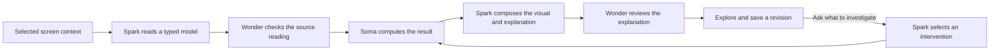

# Soma

[](https://github.com/Jeremiah-Sakuda/soma/actions/workflows/ci.yml)

**Turn what you’re studying into something you can explore.**

Soma turns a diagram on your screen into a visual you can investigate. Meta’s Muse Spark reads the material, explains it and chooses an experiment. Soma computes the consequences: cut a graph connection, change its cost or open a resistor, and see the result on the original slide.

[Try Soma in your browser](https://soma-woad-beta.vercel.app/explore) · [Download for macOS](https://github.com/Jeremiah-Sakuda/soma/releases/latest/download/Soma-macOS-arm64.zip) · [Release 0.5.0](https://github.com/Jeremiah-Sakuda/soma/releases/tag/v0.5.0)

The browser needs no account. The companion requires Apple Silicon and macOS 14.2 or newer; version 0.5.0 is Developer ID signed, Apple-notarized and stapled. [Installation and permissions](docs/DESKTOP.md).

## Try it

1. Open Soma and choose **Watch a recorded Muse run**. This is an actual completed generation, with its original model actions, time and cost visible. Opening it makes no model call. Prepared examples are labeled separately.
2. Cut a graph connection or change a cost. The checked route updates immediately, without inference. On the circuit example, open a resistor or change its value to recompute voltages and currents.
3. Ask a follow-up about the changed experiment. Choose **Investigate my question** to let Muse select what to vary while Soma computes the boundary. Save the revision and reopen it with the same controls.

For a fresh generation, choose **Upload screenshot**, or **More examples → Try the Lecture 14 slide (live)**. The [original graph slide](public/examples/lecture-14-dijkstra.png) and [circuit slide](public/examples/lecture-9-bridge.png) are included. Recent hosted first generations took 45–49 seconds; local manipulations are immediate. These are observed examples, not promised timings. Live generation is subject to shared usage limits; recordings remain available without inference.

On Mac, **Option–Space** opens the compact question bar. Soma captures the selected display, draws over the source and can lift a supported visual into 3D with **⌘L**. The menu-bar icon brings Soma back after hiding. Optional **Point & ask** combines an explicit capture, cursor gesture and spoken question; it is not continuous screen monitoring.

## How it works



Source-reading and explanation reviews are bounded, fallible checks; unavailable or skipped checks remain visible. A solver establishes consequences of the **interpreted input**, not the accuracy of every pixel reading or sentence. [Architecture and model roles](docs/ARCHITECTURE.md).

| Capability | Current boundary |
| --- | --- |
| Checked graph search | BFS and Dijkstra, nonnegative costs, up to 12 nodes and 24 edges |
| Checked circuits | Ideal DC resistor, voltage-source and current-source networks, up to 10 nodes and 16 parts; exact rational nodal analysis |
| Other screenshots | Typed explanatory diagrams, illustrative mechanisms or clarification; no arbitrary simulation claim |
| 3D | Checked values drive graph/circuit views. The built-in engine is illustrative: Muse chooses placement and teaching poses; Soma supplies its parts and motion. |
| Continuity | Contextual follow-ups and saved, versioned experiments; private screenshot pixels are not saved |

Muse Spark 1.3 handles vision, experiment selection and composition. Muse Wonder 1.0 checks source readings and reviews explanations when enabled and admitted. Muse Voice Transcribe handles optional spoken questions. Optional narration uses Gemini 3.1 Flash TTS; captions and manual steps also work. No fine-tuned or open-weight runtime is claimed.

## Run locally

Use Node 22 (the exact version is in [.nvmrc](.nvmrc)).

```sh
npm ci
cp .env.example .env.local
npm run dev
```

Open `http://127.0.0.1:3000/explore`. The default configuration uses local synthetic storage and disables live inference. Prepared examples work without provider credentials. [Setup](docs/LOCAL_SETUP.md) explains live Meta access, Firestore and optional services.

```sh
npm run typecheck
npm test
node --test desktop/test/*.test.cjs
npm run build
npm run check:browser-artifact
npm run test:e2e
npm run format:check
```

Provider, paid-inference and device-dependent checks are explicitly gated; an offline pass does not establish those behaviors. [Executed verification](docs/VERIFICATION.md) records results and limits. [Source evaluations](docs/GENERAL_SCREENSHOT_VALIDATION.md) retain unsuccessful attempts as well as successes. These are small development samples, not proof of learning improvement or general reliability.

## Repository guide

- [Product requirements](docs/PRD.md), [implementation map](docs/SOMA_V2_IMPLEMENTATION.md) and [developer handoff](CODEX_HANDOFF.md)
- [Architecture](docs/ARCHITECTURE.md), [security boundaries](docs/SECURITY.md) and [auditability](docs/AI_AUDITABILITY.md)
- [Desktop companion](desktop/README.md), [Point & ask](docs/POINT_AND_ASK.md) and [UI guidance](docs/UI_UX_GUIDE.md)
- [Recording provenance](src/lib/fixtures/RECORDINGS.md) and [third-party notices](THIRD_PARTY_NOTICES.md)

`src/lib/domain` contains the deterministic models and typed contracts; `src/lib/server` owns bounded inference, validation and persistence; `src/components` renders the experience; `desktop` contains the restricted Electron companion. Earlier course-workspace routes and isolated connector services remain available, but course setup does not block exploration.

Keep credentials, captured screens and learner records out of source control. Original synthetic examples are labeled; third-party evaluation figures retain their attribution and licenses. The notarized download is reproducible against the immutable `v0.5.0` source tag; later source formatting on `main` does not replace that signed artifact.
