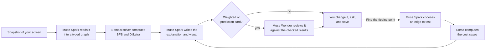

# Soma

**Point at a diagram. Change it. See what actually happens.**

Soma is a macOS study companion that turns what is on your screen into an experiment you can run. Meta's Muse models read the screen, decide what is worth testing and explain the result. On supported graphs, every path, cost and search state you see is computed by Soma's own solver, not written by a model. **The model proposes; the code proves.**

**[Try it in your browser](https://soma-woad-beta.vercel.app/explore)** (no account needed) · **[Download for macOS](https://github.com/Jeremiah-Sakuda/soma-hackathon/releases/tag/v0.3.0)** (Apple Silicon, signed and notarized)

**Native interaction (0.3.0):** enable **Point & ask**, hold **Control–Option–Space**, point or circle while speaking, and release to ask about that region. The local trail responds immediately; Muse prepares the visual afterward. Step highlights now link back to the captured source. Compare a new capture with the prior one, or ask for a closer look at a formula. Native source references require an unchanged screen. The download above is Developer ID signed, Apple-notarized and stapled. Streaming speech is tested locally; its cloud relay awaits provisioning approval. [Details and verification](docs/POINT_AND_ASK.md).

In the browser, **Watch a recorded Muse run** opens a real completed Spark and Wonder run on an original synthetic screenshot. Its original timing, cost and model actions are shown, and opening it needs no inference. The prepared examples load instantly too. New questions use live generation.

**Take it beyond the example.** Save a checked exploration and choose **Try a fresh example**. Soma creates a different problem in the same algorithm family, keeps its solution hidden until you answer or reveal it, and retains your original answer and any hints. Open the checked practice visual or ask Muse to explain your answer. Practice stays inside the exploration; it is not a mastery score.

<!-- Add the three-minute demo video link to the line above before submission. -->

## Why Soma exists

Lecture slides are frozen. A slide shows one graph, one route and one answer. Understanding comes from the questions the slide cannot answer: what if this edge cost more? What if I start somewhere else? Why didn't it take the direct route?

Today a student has two options, and neither fits the moment:

- **An AI chat** explains the slide in paragraphs or draws a new picture. Nothing in the answer can be changed, and nothing in it is checked.
- **An algorithm visualizer** lets you experiment, but first you have to find one and re-enter your slide's example by hand.

Soma closes that gap. Press **⌘⇧Space** over the slide and ask your question. Soma rebuilds that diagram beside your work as a live experiment. Switch off a connection, move the start or goal, or test a different cost, and the checked result updates.

Soma grew out of its builder's own study routine, which already runs through Meta's assistant for checking Blackboard, Gradescope and email. The missing piece was the moment of understanding itself: turning the material on screen into something you can poke.

## What happens when you ask



1. **Capture.** ⌘⇧Space snapshots the display under your cursor. You review the snapshot, and it is not sent until you ask.
2. **Read.** Muse Spark reads the pixels and returns the graph as typed data: nodes, edges, direction, costs, start and goal. If the screenshot is ambiguous or unreadable, Soma asks a clarifying question or declines to publish rather than guessing.
3. **Compute.** Soma runs breadth-first search and Dijkstra's algorithm on that graph. Every highlighted path, queue state and route cost on screen comes from this computation.
4. **Experiment.** On a weighted graph, click **Find the tipping point** and Spark picks the edge most worth investigating. Soma computes how both routes change as that edge's cost changes. When the edge runs directly from start to goal, that includes the exact cost where the two routes tie. The cost slider then re-runs both searches in your browser at any value, with no further model call.
5. **Explain.** Spark writes the explanation, steps and narration around the checked results. For weighted and prediction-informed cards, Muse Wonder reviews the finished card against those results as an advisory critic and can send it back for one repair.
6. **Follow up and save.** Ask about any node or edge, and your changes carry into the answer instead of resetting. Versions are saved and can be reopened.

## Why it matters

**It meets students at the moment they are stuck.** There are no course uploads and no setup, and you don't need an account to try it. Soma works on whatever is on screen: slides, documentation, code, spreadsheets and worksheets. Graph search, a core topic in intro AI and algorithms courses, is the first fully checked subject. Other material gets a step-by-step explanatory visual.

**It turns reading into doing.** Algorithm-visualization research found that what learners *do* with a visualization matters more than what it shows ([Hundhausen, Douglas & Stasko, 2002](https://doi.org/10.1006/jvlc.2002.0237)). The same research community describes changing a visualization's inputs as deeper engagement than viewing it ([Naps et al., 2002](https://doi.org/10.1145/960568.782998)). Soma brings that kind of engagement to the exact example a student is studying, straight from the screen.

**It keeps the student doing the thinking.** In a field experiment with nearly a thousand high-school students, those who leaned on unrestricted GPT-4 during practice did worse when later tested on their own, and a tutor with learning safeguards largely avoided that harm ([Bastani et al., PNAS 2025](https://doi.org/10.1073/pnas.2422633122)). Soma is built around that finding:

- You can predict the next step before Soma reveals it.
- Your prediction is checked and kept.
- Exploring and practice with the diagram visible never count as proof you understand.

## How Soma uses Meta's models

Each model has a defined job, and none of them is trusted blindly.

| Model | Job in Soma | How it is held to account |
| --- | --- | --- |
| **Muse Spark 1.3** | Reads the screenshot (`inspect_source`), chooses the edge to test (`choose_cost_probe`) and writes the visual and explanation (`compose_exploration`, `compose_cost_experiment`) | Strict tool schemas are bound to the request's own IDs and versions. Output that fails validation goes back with structured findings for one bounded repair, or it is not published. |
| **Muse Wonder 1.0** | Advisory reviewer for weighted and prediction-informed cards: approves, or requests a revision | It reviews the explanation against the solver's results, after the application's own checks have passed. |
| **Muse Voice Transcribe 1.0** | Turns a spoken question into text | You click to record. Soma does not store the recording. |

**Where the reasoning shows up.** Spark decides *which experiment to run* on this particular graph; the application decides *what the answer is*. Every generated card shows its own pipeline (Spark read the source, Soma computed, Spark composed, Wonder reviewed or did not run), and a "How this card was prepared" panel lists the actual calls, events, time and cost. In testing, Wonder caught real defects: a Dijkstra frontier mislabeled as a first-in-first-out queue, and misleading wording about tied routes. On a live follow-up, it sent a card back for one revision before approving it.

**What the models never do:** compute paths, costs or search states, run code, write learner records, change validation rules or spend outside the application's budget.

Narration audio uses Gemini 2.5 Flash TTS, because the Meta models offered for this event include transcription but not speech synthesis. The browser's own voice is a one-click alternative, and captions are always on.

## What we tested this week

These are small development samples, frozen before any model call, with the answer key never sent to the model. They are evidence that the pipeline works on varied input, not a measured reliability rate.

| Check | Result |
| --- | --- |
| Fresh original graph images (small, 3–4 nodes) | **8 of 8 read exactly.** Nodes, edges, direction, start, goal and costs all matched, and the results matched an independent Floyd–Warshall reference. The set covered reverse traversal, zero and fractional costs, ties, cycles and disconnected graphs. |
| The full frozen set of 13 original sources | **12 of 13 intended outcomes.** Process diagrams became explanatory visuals, blank material got a clarifying question, and negative costs were correctly refused by the solver. The miss was a graph with missing costs, which was rejected safely instead of prompting a clarifying question. |
| Nine screenshots: three real public pages (MDN, Google's ML course, OpenStax) and six original test images (two code variants, spreadsheet, circuit, cache diagram, unreadable crop) | **8 of 9 first requests** produced a source-specific explanation or a clarifying question. The code example changed correctly when the values on screen changed. The OpenStax page was rejected safely. |
| Solver correctness | Dijkstra matches exhaustive simple-path costs, and BFS matches independent reference traces ([tests/domain](tests/domain)). |
| Engineering | More than 1,300 offline tests and over 100 browser journeys, run by public CI on every push. Signed and notarized macOS app. |
| A typical live turn | 3 Meta calls in roughly 10–20 seconds, about $0.04. A follow-up with a Wonder revision used 4 calls, 22 seconds and $0.09. |

Details and method: [verification record](docs/VERIFICATION.md) · [general screenshots](docs/GENERAL_SCREENSHOTS.md) · [architecture](docs/ARCHITECTURE.md)

## Built during the hackathon

Everything in this repository is original work written for the Meta Global AI Developer Hackathon. Work began at kickoff on October 26, 2026, after the organizers opened building. Third-party packages are listed in [THIRD_PARTY_NOTICES.md](THIRD_PARTY_NOTICES.md). This repository is a reviewed snapshot; the working history stays private because it contains private course material and development records.

- **The visual exploration engine** (`/explore`): capture or upload, Spark interpretation, the checked solver, generated scenes, manipulation, contextual follow-ups and versioned saves.
- **Checked BFS and Dijkstra engines**, the model-chosen cost experiment, and weighted animation that replays the solver's own settlement and relaxation steps.
- **Visible model pipeline and a recorded live run** that judges can open without spending inference.
- **The macOS companion**: global shortcut, display snapshot with preview, floating panel and a restricted bridge to native features. It is signed and notarized.
- **Voice**: Muse transcription for spoken questions, plus narrated, captioned playback that paces the animation.
- **Platform**: ownership-fenced persistence, cancellation, application-enforced spend limits and a release fingerprint that matches this source to production (`node scripts/verify-release.mjs`).
- **Earlier in the event:** a semester course workspace with read-only Blackboard, Gradescope and Piazza connectors. It remains in the repository for its existing routes but is not part of the demo.

## What comes next

- **More checked subjects.** Each new subject needs a solver, a schema and a renderer; the capture, model and review pipeline stays the same. DC resistor circuits are the next candidate: Soma already explains circuit screenshots, and a solver would make them manipulable.
- **Classroom pilots** that measure what students can do on their own afterward, not just what they did with help.
- **Course awareness.** Reconnect the course workspace so a new lecture arrives with its experiment ready.

## Scope

- Checked computation covers BFS and Dijkstra with nonnegative costs, up to 12 nodes and 24 edges. Everything else is an explanatory visual, labeled that way in the app. It is not a simulation.
- Reading a screenshot can go wrong. The **Source & assumptions** panel shows Spark's reading of the source and the uncertainty it reported. That reading is shown for inspection; it is not independently re-checked.
- Browser upload is the fully verified capture path. The desktop shortcut passes automated policy and synthetic capture checks. Real Screen Recording permission, multi-display capture and clean-Mac installation are being tested by hand.
- Learning gains and use in real courses have not been measured yet.
- Soma takes one snapshot when you ask. It does not record your screen, and screenshots are not stored.
- Guest explorations last 24 hours. Live generation runs under a spend cap; the prepared examples need no model call.

## Run it yourself

Use Node 22 (`.nvmrc`). Dependencies are pinned.

```sh
npm ci
cp .env.example .env.local
npm run dev
```

Open `http://127.0.0.1:3000/explore`. The defaults use local synthetic persistence with live inference off, so the prepared examples work without credentials. For live generation, set `MODEL_API_KEY`, `SOMA_LIVE_INFERENCE=true`, `META_ALLOCATION_USD` and a bounded `META_APP_SPEND_CAP_USD`. Set `SOMA_EXPLORATION_REVIEW_ENABLED=true` for Wonder review. Optional narration and Firestore persistence are described in `.env.example`. Never commit a filled environment file.

**macOS companion:** `npm ci --prefix desktop && npm start --prefix desktop`. Capture needs macOS Screen Recording permission, and voice needs microphone permission. See [desktop notes](docs/DESKTOP.md).

**Verify:**

```sh
npm ci --prefix services/browser-runner --ignore-scripts
npm ci --prefix services/credential-runner --ignore-scripts
npm run typecheck && npm test && npm run build
npx playwright install chromium && npm run test:e2e
npm test --prefix desktop
```

Default tests are offline and use original synthetic material. Tests that call real providers are opt-in.
