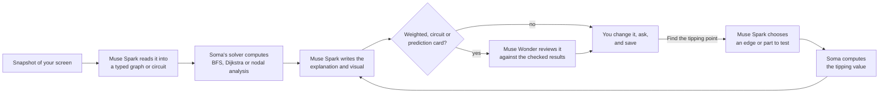

# Soma

**Turn what you’re studying into something you can explore.**

Soma turns a diagram on your screen into an experiment with computed routes, voltages and currents. Meta’s Muse models read the source, explain it and choose what to investigate; Soma’s own solver computes on that reading and draws the result back onto the source, where you can cut a connection or open a resistor, change a cost or a value, or ask about the consequence. Two subjects are checked today, graph search and DC circuits. It starts with students: the slide you're studying becomes something you can test.

The opportunity: less setup between encountering a difficult idea and having a useful way to explore it, first in the classroom and potentially, with the same solver, on graphs people read outside it. [Demo story](docs/STORY_AND_DEMO.md) · [Three-minute script](docs/DEMO_VIDEO_SCRIPT.md) · [Submission copy](docs/SUBMISSION.md)

**[Try it in your browser](https://soma-woad-beta.vercel.app/explore)** (no account needed) · **[Download for macOS](https://github.com/Jeremiah-Sakuda/soma/releases/tag/v0.4.0)** (0.4.0, Apple Silicon, Developer ID signed and notarized: the overlay drawn on your screen, the compact bar and the 3D lift)

**November 4 verification:** [Clean CI passed](https://github.com/Jeremiah-Sakuda/soma/actions/runs/41785787908) after the 3D geometry, precision, source-check and recovery fixes. [Executed checks and limits](docs/VERIFICATION.md) separate local renderer proof from physical native acceptance. Signed/notarized 0.4.1 remains a private draft; current hosted/native acceptance is pending. The download above remains 0.4.0.

**Try one live slide.** Open [Soma](https://soma-woad-beta.vercel.app/explore) and choose **Try the Lecture 14 slide (live)**. Allow about a minute for the source reading and explanation: a recent hosted run took 49 seconds. Muse Spark reads the slide, Wonder checks the reading, and Soma runs Dijkstra **on the slide itself**. Click the D–F connection to cut it: the route changes to A–C–E–F, cost 9, immediately with no model call. Then restore it, use **Clear selected object** beside the question if a connection is selected, and ask *“What would make the route go through E?”* Choose **Investigate my question**; Muse picks the connection and Soma computes its boundary. The drawn routes, distances and costs come from Soma’s solver; Wonder's review of the explanation is advisory. To supply the source yourself, download [the original Lecture 14 slide](public/examples/lecture-14-dijkstra.png), choose **Upload screenshot** and ask *“Why doesn’t it just take the direct A-to-F edge?”*

**Try a second subject.** Choose **Try the Lecture 9 circuit slide (live)**, or upload [the original Lecture 9 bridge slide](public/examples/lecture-9-bridge.png), and ask *“Why is there no current through R5?”* Spark reads the circuit, Soma solves that reading exactly by nodal analysis and draws the voltages and currents on the slide. Click a resistor to open it, or choose **Find the tipping point**: Muse picks the part to vary and Soma computes where the current through R₅ reverses. A recent hosted reading took 45 seconds and its investigation took 32 seconds; these are examples, not promised timings. Those timings are from the earlier review6 release; the new reported deployment includes circuit image checking, with hosted acceptance still pending. The [Soma lab engine](https://soma-woad-beta.vercel.app/lab/engine/index.html) is a separate recorded Muse run.

**Native interaction:** enable **Point & ask**, hold **Control–Option–Space**, point or circle while speaking, and release to ask about that region. Or press **Option–Space** for the compact ask bar: type a question, and Soma draws the checked search over the slide on your screen while its panel stays closed; press ⌘L to lift it into 3D, each vertex raised to its checked distance. The local trail responds immediately; Muse prepares the visual afterward. Step highlights now link back to the captured source. Compare a new capture with the prior one, or ask for a closer look at a formula. Native source references require an unchanged screen. The 0.4.0 download above is Developer ID signed, Apple-notarized and stapled, and Gatekeeper accepts it. Streaming speech is tested locally; its cloud relay awaits provisioning approval. [Details and verification](docs/POINT_AND_ASK.md).

In the browser, **Watch a recorded Muse run** opens a real completed Spark and Wonder run on an original synthetic screenshot. Its original timing, cost and model actions are shown, and opening it needs no inference. The prepared examples load instantly too. New questions use live generation.

After opening a recorded run, the **Recorded graph** and **Recorded circuit** buttons switch between actual November 4 UTC investigations on the original demo slides. Asked *“What would make the route go through E?”*, Muse chose D–F and Soma computed a tie at cost 5; asked about R₅ current, Muse chose R₄ and Soma verified balance at 8 Ω. Original generation receipts and source readings remain intact. Any deterministic replay drawing alignment is identified separately. [Recording provenance](src/lib/fixtures/RECORDINGS.md).

**Take it beyond the example.** Save a checked exploration and choose **Try a fresh example**. Soma creates a different problem in the same algorithm family, keeps its solution hidden until you answer or reveal it, and retains your original answer and any hints. Open the checked practice visual or ask Muse to explain your answer. Practice stays inside the exploration; it is not a mastery score.

<!-- Add the three-minute demo video link to the line above before submission. -->

## Why Soma exists

A lecture diagram gives you one example. The question you want to ask is often more specific: what if I change this connection, start somewhere else, or compare these two states?

Making that example interactive can require translating it into another tool or finding a demonstration that matches. Soma starts from the selected source and question, so the explanation can stay connected to what you are already working on.

Soma is built for students and independent learners first. The potential is a shorter path from a moment of confusion to a useful investigation. The graph workflow makes that idea concrete: change a connection or cost, see the checked consequence, ask about it, and keep the revised exploration.

Soma grew out of its builder’s study workflow with Meta’s assistant. Its focus is the moment of understanding: giving the material in front of you something you can manipulate and investigate.

## What happens when you ask



1. **Capture.** ⌘⇧Space snapshots the display under your cursor. You review the snapshot, and it is not sent until you ask.
2. **Read.** Muse Spark reads the pixels into a typed graph or circuit. Wonder checks the full original graph image, with a detail crop if available; disputed weights receive a blind Spark re-read, and corrections require agreement. Wonder also checks circuit components, values, connections and source polarity. Disputed circuit values receive a blind re-read; an unresolved circuit dispute prevents a checked circuit. An unavailable check is reported as unchecked. Soma aligns circuit marks with the drawn junctions and parts. The reading, uncertainty and check status remain inspectable; model agreement can still be wrong.
3. **Compute.** Soma runs breadth-first search and Dijkstra's algorithm on a graph, or solves a circuit exactly by nodal analysis in fractions, publishing it as checked only if Kirchhoff's current law, every source's voltage and the power balance hold exactly. Every highlighted path, queue state, route cost, voltage and current on screen comes from this computation.
4. **Experiment.** On a weighted graph, click **Find the tipping point** and Spark picks the one edge your question turns on. Soma computes, for that edge, the cost at which the cheapest route starts or stops using it, and the cheapest route without it. The cost slider then re-runs both searches in your browser at any value, with no further model call. On a circuit, Spark picks the part to vary and what to watch; Soma finds the exact value where that current or voltage reaches zero (or where a resistor takes the most power) and re-solves the circuit there to verify it.
5. **Explain.** Spark writes the explanation, steps and narration around the checked results. For weighted-graph, circuit and prediction-informed cards, Muse Wonder reviews the finished card against those results as an advisory critic and can send it back for one repair.
6. **Follow up and save.** Ask about a node, connection or part, and your changes carry into the answer instead of resetting. Saved versions preserve the interpreted diagram and experiment state. Private screenshot pixels are not stored; reopening without the capture uses the diagram view. The release source separately retains allowlisted original public demo images for recorded and recognized demo sources.

## Why it could matter

**Bring the experiment to the example.** A student could explore the diagram they are studying without reconstructing it by hand in a separate visualizer.

**Make a question actionable.** Instead of stopping at a fixed explanation, the user can change a meaningful input and inspect the consequence. On supported graphs, those consequences come from a checked computation.

**Keep the investigation connected.** Contextual follow-ups and saved revisions let the user continue from the current experiment. The opportunity is less setup and more direct exploration; no quantified time-saving or learning-gain result is claimed.

**Reach past the classroom.** The checked step doesn't depend on the picture being a slide: Muse reads a picture into a typed graph or circuit, Soma's solver computes on it, and the result is drawn back onto the picture. The same questions come up on a transit map, a network diagram or a delivery route, which is where Soma could go next.

## Exploring a richer visual language

On the experimental spatial branch, a recorded engine study shows actual Muse-authored vector artwork, teaching copy and visual investigation choices. Compare matching piston positions across different strokes, inspect the connecting rod and export the question/action/explanation as a standalone study file. Soma supplies constrained motion and source/artifact checks.

This is a recorded local prototype alongside the canonical graph product. It is not integrated generic engine generation or cloud saving. [Engine investigations and actual evidence](docs/examples/pm126/README.md).

## How Soma uses Meta's models

Each model has a defined job, and none of them is trusted blindly.

| Model | Job in Soma | How it is held to account |
| --- | --- | --- |
| **Muse Spark 1.3** | Reads the screenshot (`inspect_source`, `locate_graph`), re-reads only the labels Wonder disputes without seeing Wonder's answer (`recheck_weights`), chooses the edge or part to test (`choose_investigation`, `choose_circuit_investigation`) and writes the visual and explanation (`compose_exploration`, `compose_cost_experiment`, `compose_circuit`) | Strict tool schemas are bound to the request's own IDs and versions. Output that fails validation goes back with structured findings for one bounded repair, or it is not published. |
| **Muse Wonder 1.0** | Checks graph readings against the image (`check_reading`), and circuit readings (`check_circuit_reading`); reviews weighted-graph, circuit and prediction-informed explanations | Value corrections require agreement after a blind second look. Unresolved circuit disputes prevent a checked circuit. Reviews compare wording with computed results; their verdict is advisory. |
| **Muse Voice Transcribe 1.0** | Turns a spoken question into text | You click to record. Soma does not store the recording. |

**Where the reasoning shows up.** Spark decides *which experiment to run* on this particular graph; the application decides *what the answer is*. Every generated card shows its own pipeline (Spark read the source, Soma computed, Spark composed, Wonder reviewed or did not run), and a "How this card was prepared" panel lists the actual calls, events, time and cost. In testing, Wonder caught real defects: a Dijkstra frontier mislabeled as a first-in-first-out queue, misleading wording about tied routes, a step on the Lecture 14 slide claiming two vertices settled at once ([receipt](docs/examples/hero-dijkstra/receipts/wonder-review.json)), a reversed current in a six-node circuit and a 12-node settlement order that skipped a vertex ([results](tests/fixtures/source-evaluation-v2/results.json)). Each card went back for one repair before approval. Spark's stated reason for an experiment is dropped if it contains a number. Checked captions drawn on the source or native overlay come from the current calculation; authored notes remain separately labeled. The browser's 3D height view also prints the current checked values, distinguishing tentative distances and unrevealed voltages. Numbers in narration are checked only by Wonder's review.

**What model output cannot control:** the authoritative paths, costs, search states, voltages or currents. Those come from Soma's solvers. Generated content cannot run code, write learner records, change validation rules or spend outside the application's budget. Source reading and explanatory prose can still be wrong.

Narration audio uses Gemini 3.1 Flash TTS (preview, Sulafat voice), because the Meta models offered for this event include transcription but not speech synthesis. The words are the explanation on screen; Gemini only voices them. The browser's own voice is a one-click alternative, and captions are always on.

## What we tested this week

These are small development samples, frozen before any model call, with the answer key never sent to the model. They are evidence that the pipeline works on varied input, not a measured reliability rate.

| Check | Result |
| --- | --- |
| Fresh original graph images (small, 3–4 nodes) | **8 of 8 read exactly.** Nodes, edges, direction, start, goal and costs all matched, and the results matched an independent Floyd–Warshall reference. The set covered reverse traversal, zero and fractional costs, ties, cycles and disconnected graphs. |
| The full frozen set of 13 original sources | **12 of 13 intended outcomes.** Process diagrams became explanatory visuals, blank material got a clarifying question, and negative costs were correctly refused by the solver. The miss was a graph with missing costs, which was rejected safely instead of prompting a clarifying question. |
| A second frozen set: 12 new original slides (November 2) | **11 of 12 intended outcomes.** All six circuits were read exactly and solved to the key: two sources, a current source, kΩ and decimal values, an unmarked ground and ground on the battery's +. All five graphs, of 7 to 12 nodes, were read exactly with the key's goal cost. The miss was a capacitor circuit: Soma correctly didn't read it as a checked circuit, but its explanation failed to save. That save bug is fixed; one rerun then ran out of time on the explanation. |
| Three figures we didn't draw, from Wikimedia Commons (November 3; [attribution](tests/fixtures/real-figures/ATTRIBUTION.md)) | **All three handled as intended.** A directed weighted graph was read exactly and solved to cost 20, with Wonder confirming the reading. Wikipedia's classic numbered Dijkstra graph, a small, low-resolution frame, was read with every connection and weight right and solved to cost 20 in two runs; in one, Wonder sent the explanation back once before approving it. Spark kept the figure's printed “a”/“b” beside nodes 1 and 5 in their names, which our strict scorer counts as a mismatch. A circuit drawn with symbols but no values got a clarifying question instead of invented numbers ([results](tests/fixtures/real-figures/results.json)). |
| Nine screenshots: three real public pages (MDN, Google's ML course, OpenStax) and six original test images (two code variants, spreadsheet, circuit, cache diagram, unreadable crop) | **8 of 9 first requests** produced a source-specific explanation or a clarifying question. The code example changed correctly when the values on screen changed. The OpenStax page was rejected safely. |
| Solver correctness | Dijkstra matches exhaustive simple-path costs, and BFS matches independent reference traces. The circuit solver agrees with independent two-resistor formulas, and Kirchhoff's and Ohm's laws hold on 60 random circuits ([tests/domain](tests/domain)). |
| The original Lecture 9 circuit slide, two live service runs | **Both read exactly:** five resistors, the battery's polarity and ground. Soma solved B = C = 8 V and exactly 0 A through R₅; Wonder approved. Asked “When would current flow through R5, and which way?”, Muse chose R₄, a part the question didn't name, and Soma found exactly 8 Ω, verified by re-solving ([receipt](docs/examples/hero-circuit/receipts/live-run.json)). Replayed offline on both runs' raw readings, the current snapper puts every node within 6 px of the drawing. |
| Engineering | [Clean CI 41846607806](https://github.com/Jeremiah-Sakuda/soma/actions/runs/41846607806) passed on `7c213c4`: 1,957 application tests (107 gated skips), 75 desktop tests and 189 browser checks without retries (14 gated skips), plus types/build/manifest/isolated trace/adversarial checks. Deployment metadata reports READY. Current hosted/native acceptance and final footage remain open; [verification](docs/VERIFICATION.md) retains the earlier retried source-pointing case and all dated checkpoints. |
| One recent original-synthetic service journey | Generation, changed-edge revision and exact save/reopen passed in 27.608 seconds including application work, after retained earlier outcomes. This is an example, not a typical-latency or reliability claim ([receipts](docs/examples/pm126/recorded/canonical-service-checks.json)). |

Details and method: [verification record](docs/VERIFICATION.md) · [general screenshots](docs/GENERAL_SCREENSHOTS.md) · [architecture](docs/ARCHITECTURE.md)

## Built during the hackathon

Product code was written for the Meta Global AI Developer Hackathon, beginning at kickoff on October 26, 2026. The submission deadline is November 4. The first commit (October 26, 11:10 ET) holds only pre-event planning documents. A second history root (October 29) comes from this project's own companion repository, also built during the event, and was merged here so the full build log stays in one place. Third-party packages are listed in [THIRD_PARTY_NOTICES.md](THIRD_PARTY_NOTICES.md). The dated build log (`docs/BUILD_LOG.md`), verbatim prompt archive (`docs/build-log/prompts.json`) and git history record the work.

- **The visual exploration engine** (`/explore`): capture or upload, Spark interpretation, the checked solver, generated scenes, manipulation, contextual follow-ups and versioned saves.
- **Checked BFS and Dijkstra engines**, the model-chosen cost experiment, and weighted animation that replays the solver's own settlement and relaxation steps.
- **Checked DC circuits** (November 1–2): exact nodal analysis with Kirchhoff checks, opening parts and changing values on the slide, a model-chosen tipping point verified by re-solving, junction-dot snapping, and a 3D view in which height is voltage.
- **Visible model pipeline and a recorded live run** that judges can open without spending inference.
- **3D for any answer** (November 2): on request, Muse builds a 3D model of whatever the explanation is about, bound to its steps, from plain parts, arrows, tubes and sheets; Soma tidies it to read at a glance. A held-out set of 12 lecture slides, written by an independent agent across biology, chemistry, physics, earth science, networking, economics, engineering, maths, acoustics, materials, medicine and ecology, is scored each round by separate judge agents (`scripts/eval-3d.cjs`).
- **The macOS companion**: global shortcut, display snapshot with preview, floating panel, a compact translucent ask bar for typed questions, any answer drawn over the real screen and liftable into 3D (a search's heights are checked distances and shortest routes pull taut; a circuit's are checked voltages; any other explanation stands up as its 3D model), and a restricted bridge to native features. It is signed and notarized.
- **Voice**: Muse transcription for spoken questions, plus narrated, captioned playback that paces the animation.
- **Platform**: ownership-fenced persistence, cancellation, application-enforced spend limits and a release fingerprint that matches this source to production (`node scripts/verify-release.mjs`).
- **Earlier in the event:** a semester course workspace with read-only Blackboard, Gradescope and Piazza connectors. It remains in the repository for its existing routes but is not part of the demo.

## What comes next

- **Graphs beyond the classroom.** The same solver and overlay on diagrams people use outside a course: transit, network and route maps. Reading them is the open question, not computing them.
- **More checked subjects.** DC circuits were the second: the capture, reading, review, drawing and Mac companion stayed the same, and what was new was a solver, a reading contract and a way to draw voltages and currents. Truss statics is a natural next candidate.
- **Classroom pilots** that measure what students can do on their own afterward, not just what they did with help.
- **Course awareness.** Reconnect the course workspace so a new lecture arrives with its experiment ready.

## Scope

- Checked computation covers BFS and Dijkstra with nonnegative costs, up to 12 nodes and 24 edges, and ideal DC circuits of resistors and sources, up to 10 nodes and 16 parts. Everything else is an explanatory visual, labeled that way in the app. It is not a simulation.
- Reading a screenshot can go wrong. **Source & assumptions** exposes the interpretation, uncertainty and available image checks. The November 4 release source checks circuit images as well as graphs; hosted acceptance of that deployment is pending. Skipped checks are reported, and two models can agree on the same misreading. Solver checks establish consequences of the interpreted diagram; they do not certify source reading or generated prose.
- Browser upload is the fully verified capture path. The desktop shortcut passes automated policy and synthetic capture checks. Real Screen Recording permission, multi-display capture and clean-Mac installation are being tested by hand.
- Impact is framed around students first: easier exploration of a learner’s own material. Uses beyond the classroom are described as potential. Quantified time savings, adoption and classroom outcomes are not claimed.
- Soma takes one snapshot when you ask. It does not record your screen, and screenshots are not stored.
- Guest explorations last 24 hours. Live generation runs under a spend cap; the prepared examples need no model call.

## Run it yourself

Use Node 22 (`.nvmrc`). Dependencies are pinned.

```sh
npm ci
cp .env.example .env.local
npm run dev
```

Open `http://127.0.0.1:3000/explore`. The defaults use local synthetic persistence with live inference off, so the prepared examples work without credentials. For live generation, set `MODEL_API_KEY`, `SOMA_LIVE_INFERENCE=true`, `META_ALLOCATION_USD` and a bounded `META_APP_SPEND_CAP_USD`. Set `SOMA_EXPLORATION_REVIEW_ENABLED=true` for Wonder review. Optional narration and Firestore persistence are described in `.env.example`. Never commit a filled environment file.

**macOS companion:** `npm ci --prefix desktop && npm start --prefix desktop`. Capture needs macOS Screen Recording permission, and voice needs microphone permission. See [desktop notes](docs/DESKTOP.md).

**Verify:**

```sh
npm ci --prefix services/browser-runner --ignore-scripts
npm ci --prefix services/credential-runner --ignore-scripts
npm run typecheck && npm test && npm run build
npx playwright install chromium && npm run test:e2e
npm test --prefix desktop
```

Default tests are offline and use original synthetic material. Tests that call real providers are opt-in.


## Also in the repository

Earlier work from the same build (an understanding map across saved explorations, course-source connectors and approved computer actions) remains in the code and is documented under `docs/`. It is not part of the demo.
